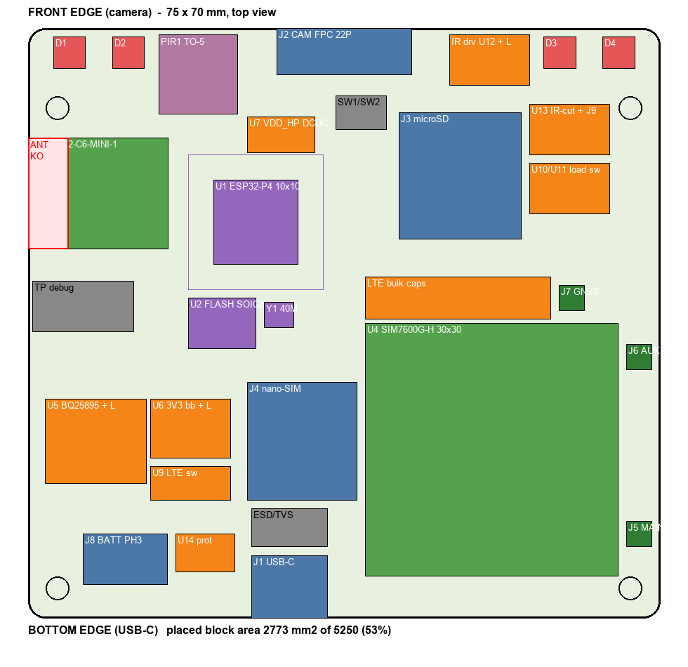

# Phase 1 — Architecture (Review 1)

Status: **Review 1 approved 2026-10-19** (mounting orientation, USB-Serial/JTAG, consigned P4/C6, shifter-free 1.8 V modem UART). Stock figures are JLCPCB assembly stock, checked 2026-10-19.
Every decision below cites the datasheet in `datasheets/` it came from.

---

## 1. Part selection

### Core ICs

| Ref | Function | Part | LCSC | JLC stock | Notes |
|---|---|---|---|---|---|
| U1 | Main SoC | **ESP32-P4NRW32X** (QFN-104, rev v3.x) | C54540373 | **0** ⚠ | Consigned or pre-order. v3.x silicon, so the v3 rules apply (§3) |
| U2 | 16 MB QSPI flash | W25Q128JVSIQ (SOIC-8 208mil) | C97521 | 60k, **basic** | 3.3 V, powered from VDDO_FLASH |
| U3 | Wi-Fi 6 / BLE | ESP32-C6-MINI-1 (PCB antenna) | C5453904 | **0** ⚠ | Consigned. Connects to the P4 over SDIO (esp-hosted) |
| U4 | LTE Cat-4 + GNSS | **SIMCom SIM7600G-H** (LCC+LGA 30×30) | C5355477 | 55 | 1.8 V I/O, 3.4–4.2 V VBAT, 2 A bursts |
| U5 | Charger / power path | TI BQ25895RTWR (QFN-24 4×4) | C80200 | 6k | I²C, JEITA via TS, BATFET 11 mΩ, ship mode |
| U6 | 3V3 buck-boost | TI TPS631000DRLR (SOT-583) | C5219190 | 62k | 1.5 A at VIN 2.7 V, **8 µA Iq** |
| U7 | VDD_HP core DC-DC | TI TLV62569DBVR (SOT-23-5) | C141836 | 450k | Espressif's verified part. Circuit in §3 |
| U8 | 1.8 V I/O LDO | TI TPS7A0218DBVR | C5144851 | 3.4k | **25 nA Iq**. Powers VDD_IO_6 (modem domain) |
| U9 | LTE power switch | TI TPS22965DSGR (16 mΩ, 6 A) | C122837 | 15k | SYS → VBAT_LTE. Low drop at 2 A bursts |
| U10, U11 | Camera / SD power switches | TI TPS22918DBVR (2 A) | C131941 | 60k | 3V3 → 3V3_CAM, 3V3_SD |
| U12 | IR LED driver | TI TPS61169DCKR (CC boost) | C71045 | 26k | 4 LEDs in series, ~300 mA, PWM dimming |
| U13 | IR-cut H-bridge | TI DRV8837DSGR | C39159 | 116k | VM = SYS, 120 nA sleep |
| U14 | Cell protection | DW01A + FS8205A | C351410 / C2830320 | 110k / 17k | On-board protection (the brief requires it) |
| U15 | Reset supervisor | TI TPS3839G33DBZR (3.08 V, 150 nA) | C485802 | 3k | Drives CHIP_PU, per the HDG advice for battery systems |
| U16 | RI level shifter | TI SN74LVC1T45DBVR | C7843 | 332k | Modem RI (1.8 V) → LP wake GPIO (3.3 V) |
| U17 | USB ESD | TI TPD4E05U06DQAR (0.5 pF) | C138714 | 212k | D+/D−/CC1/CC2. Reused on the nano-SIM lines |
| PIR1 | Digital PIR | XYC-PIR223D-S0 (TO-5, 3 pin) | C2887901 | 3.7k | 10 µA, digital REL output. **THT** |
| D1–D4 | IR LEDs 850 nm | M3838E1IRS1G09-850NM (3.8×3.8) | C2833567 | 264 | 350 mA max. Run at ~300 mA |

### Connectors and passives

| Ref | Part | LCSC | Notes |
|---|---|---|---|
| J1 | USB-C 16P, HRO TYPE-C-31-M-12 | C165948 | **Bottom edge**. 5.1 k Rd on CC1 and CC2 |
| J2 | 22P 0.5 mm FPC, bottom contact (05B20L22P) | C22459552 | **Front edge**. Pi Zero/CM camera pinout |
| J3 | microSD push-push (TF-01A) | C91145 | 181k in stock |
| J4 | Nano-SIM push-push 7P with detect | C7529384 | 42k in stock |
| J5–J7 | U.FL (IPEX-1): LTE main, LTE div, GNSS | C88374 | 50 Ω CPWG feeds, π-match pads |
| J8 | Battery: JST PH 3P SMD (BAT+, NTC, GND) | C265101 | 3-wire pack with NTC. On-board 0603 NTC as DNP fallback |
| J9 | IR-cut filter: 1.0 mm 2P SMD | C2904984 | |
| Y1 | 40 MHz ±10 ppm 3225 crystal | C9010 | 43k in stock. Load caps tuned per §3 |
| Y2 | 32.768 kHz crystal (RTC accuracy in deep sleep) | TBD (SMD 2012/3215) | Optional. Without it, GPIO0/1 are free |
| RT1 | NTC 10 k B3435 (NCP18XH103F03RB) | C13564 | DNP if the pack carries its own NTC |
| SW1/SW2 | BOOT (GPIO35) and RESET, TS-1088 4×3 mm | C455278 | |
| D5 | VBUS TVS SMF5.0A | C193402 | |

**Sourcing risk:** The P4 and C6 show zero JLC stock today. Plan on consigned parts or JLC global sourcing. The BOM will mark them `consigned` so the board order still goes through.

## 2. Power tree

```
USB-C VBUS 5V ─TVS─► BQ25895 ──SYS (3.5–4.35 V)──┬─► TPS631000 buck-boost ──► 3V3 (1.5 A)
                       │ BAT (BATFET 11 mΩ)       │        ├─► TLV62569 (EN_DCDC from P4) ──► VDD_HP 1.1 V
                       ▼                          │        ├─► TPS7A0218 ──► 1V8_IO6 (P4 VDD_IO_6, RI shifter A-side)
            DW01A/FS8205A ── 1S Li-ion (NTC→TS)   │        ├─► TPS22918 ──► 3V3_CAM ──► FPC pin 22
                                                  │        ├─► TPS22918 ──► 3V3_SD  ──► microSD
                                                  │        └─► P4 / flash / C6 / PIR / DRV8837 VCC
                                                  ├─► TPS22965 ──► VBAT_LTE ──► SIM7600G-H (≥300 µF bulk)
                                                  ├─► TPS61169 ──► IR LED string (4S)
                                                  └─► DRV8837 VM ──► IR-cut filter coil
```

**Why the modem runs from SYS rather than 3V3:** The SIM7600 needs 3.4–4.2 V and draws 2 A bursts. SYS follows the battery (≤4.2 V on the charge profile), so the modem gets the cell directly through a 16 mΩ switch and never passes through a converter.

## 3. ESP32-P4 power and support circuitry (HDG v3.x rules)

Source: `datasheets/ESP32-P4_hw_design_guidelines.pdf` (Fig. 5) and the Espressif online schematic checklist.

| Pin(s) | Supply | Decoupling |
|---|---|---|
| VDD_LP (9), VDD_ANA (101) | 3V3 | 0.1 µF each |
| VDD_IO_0 (21), VDD_IO_4 (62), VDD_IO_5 (85) | 3V3 | 0.1 µF each |
| **VDD_IO_6 (96)** | **1V8_IO6** (TPS7A0218) | 0.1 µF. Puts GPIO49–54 at the modem's 1.8 V level, so no level shifters on the UART |
| VDD_BAT (102) | 3V3 (never floating) | 0.1 µF + 10 µF |
| VDD_LDO (75), VDD_DCDCC (77) | 3V3 | 10 µF on the trace + 0.1 µF each |
| VDD_HP_0/1/2/3 (26, **54**, 76, 91) | VDD_HP from TLV62569 | 10 µF at the source + 0.1 µF per pin. Pin 54 is VDD_HP_1 on v3 |
| VDD_FLASHIO (30) ← VDDO_FLASH (71) | Internal 3.3 V | 1 µF on VDDO_FLASH. 0.1 µF + 1 µF on VDD_FLASHIO |
| VDD_PSRAM_0/1 (59, 67) ← VDDO_PSRAM (72) | Internal ~1.9 V | 1 µF on VDDO_PSRAM. 0.1 µF + 1 µF at each pin |
| VDDO_3 (73), VDDO_4 (74) | Internal (unused) | 1 µF each, no load |
| VDD_MIPI_DPHY (41) | Internal 2.5 V | 10 nF + 0.1 µF + 1 µF |
| VDD_USBPHY (51) | Unused (HS PHY not used, see §5) | Left floating per the HDG. Saves the v1.x leakage problem entirely |
| CSI_REXT (48) | — | 4.02 k 1 % to GND |
| DSI_REXT (34), DSI_* | Unused | Floating |

- **VDD_HP DC-DC (TLV62569):** VIN = 3V3 with 4.7 µF. L = 2.2 µH. COUT = 22 µF. **R1 = R2 = 499 k, C = 22 pF feedback (mandatory on v3)**. EN ← EN_DCDC (pin 79). FB node ↔ FB_DCDC (pin 78).
- **CHIP_PU (103):** 10 k / 1 µF RC, plus the TPS3839 (3.08 V) supervisor. A battery rail ramps slowly, which is the case the HDG flags.
- **40 MHz crystal:** C_L = (C1·C2)/(C1+C2) + C_stray. For a 15 pF crystal with ~3 pF stray, start at 22 pF and tune at bring-up.
- **Straps:** GPIO35 has a 10 k pull-up and the BOOT button to GND, with no big capacitor (HDG warning). GPIO34/36/37/38 stay at their defaults.
- **Flash:** 10 k pull-up on FLASH_CS and 0 Ω series pads on all six QSPI lines.

## 4. Power budget

| Load | Rail | Typ. active | Peak | Sleep (target) |
|---|---|---|---|---|
| ESP32-P4 + flash + PSRAM | 3V3 | 400 mA | 500 mA | 12 µA (deep sleep, LP timer) |
| ESP32-C6-MINI-1 | 3V3 | 100 mA | 350 mA (TX) | ~1 µA (CHIP_EN low) |
| Camera (OV5647/IMX219 class) | 3V3_CAM | 150 mA | 200 mA | 0 (switched off) |
| microSD | 3V3_SD | 50 mA | 100 mA | 0 (switched off) |
| PIR223D | 3V3 | 10 µA | — | 10 µA (always on, wake source) |
| **3V3 total** | | ~700 mA | **~1.15 A** (TPS631000: 1.5 A) | |
| SIM7600G-H | VBAT_LTE | 500–700 mA (LTE) | **2 A** (GSM burst) | 0 (switched off) |
| IR LEDs 4S @ 300 mA | SYS | ~0.75 A from SYS | | 0 |
| IR-cut coil | SYS | — | ~200 mA × 100 ms | 0 |
| Fixed overhead | | | | TPS631000 8 µA, BQ25895 ~12–23 µA, DW01A 3 µA, TPS7A02 25 nA, TPS3839 150 nA |

**Worst-case SYS peak is about 4 A** (3V3 at 1.15 A through the converter, plus a 2 A modem burst, plus 0.75 A of IR). The BQ25895 BATFET and a ≥1C, ≥2500 mAh cell carry this. The firmware rule is never to fire IR during a GSM burst; LTE-only bands do not burst at 2 A.

**Sleep estimate: about 40–50 µA**, so a 3000 mAh cell idles for years. The real limit is the wake duty cycle.

## 5. ESP32-P4 pin map

| GPIO | Domain | Function | Why there |
|---|---|---|---|
| 0, 1 | VDD_LP | XTAL_32K_N / P | Fixed function |
| 2 | VDD_LP | **PIR_OUT** (wake) | LP domain, so it can wake from deep sleep |
| 3 | VDD_LP | **CHG_INT** (BQ25895 INT, wake) | USB plug-in and charge faults wake the SoC |
| 4 | VDD_LP | **MODEM_RI_3V3** (via SN74LVC1T45, wake) | An SMS or call wakes the SoC |
| 5, 6 | VDD_LP | SYS_SDA / SYS_SCL (BQ25895) | LP_I2C, so the LP core can poll the charger. Verify the LP_I2C pin mux in the TRM |
| 7 | VDD_LP | MODEM_PWRKEY (NMOS, open-drain to modem) | Held through sleep |
| 8 | VDD_LP | MODEM_PWR_EN (TPS22965 EN) | Held through sleep |
| 9 | VDD_LP | C6_EN | Held through sleep |
| 10 | VDD_LP | **C6_WAKE** (C6 IO2 → P4, wake) | Wi-Fi traffic can wake the P4 from deep sleep (esp-hosted host-wakeup) |
| 11 | VDD_LP | MODEM_RESET (NMOS) | |
| 12, 13 | VDD_LP | Spare → test pads | |
| 14, 15, 16, 17 | LP / IO_0 | C6 SDIO D0–D3 | Matches the ESP32-P4-Function-EV esp-hosted default |
| 18, 19 | VDD_IO_0 | C6 SDIO CLK / CMD | Same esp-hosted default |
| 20, 21 | VDD_IO_0 | CAM_SDA / CAM_SCL | Separate bus, so a powered-off camera cannot clamp the system I²C |
| 22 | VDD_IO_0 | CAM_IO0 (power-down / enable) | |
| 23 | VDD_IO_0 | CAM_PWR_EN (TPS22918) | |
| 24, 25 | VDD_IO_4 | **USB D− / D+ (USB-Serial/JTAG) → USB-C** | Flash, console and JTAG with no firmware; the board can't be bricked |
| 26 | VDD_IO_4 | C6_BOOT (C6 GPIO9) | Lets the P4 put the C6 into download mode |
| 27 | VDD_IO_4 | IRCUT_nSLEEP | |
| 28 | VDD_IO_4 | SD_PWR_EN (TPS22918) | |
| 29 | VDD_IO_4 | CAM_IO1 | |
| 30, 31 | VDD_IO_4 | IRCUT_IN1 / IN2 (DRV8837) | |
| 32 | VDD_IO_4 | IR_LED_PWM (TPS61169 CTRL) | |
| 33 | VDD_IO_4 | Spare → test pad | |
| 34, 36 | VDD_IO_4 | Straps, left default | |
| 35 | VDD_IO_4 | BOOT button (strap, 10 k pull-up) | |
| 37, 38 | VDD_IO_4 | UART0 TX / RX → test pads | Boot log |
| 39–44 | VDD_IO_5 (3.3 V) | microSD D0–D3, CLK, CMD (SDMMC slot 0, fixed pins) | 4-bit HS at 3.3 V. No UHS-I, so VDD_IO_5 stays at 3V3 |
| 45 | VDD_IO_5 | SD_DET | |
| 46–48 | VDD_IO_5 | Spare | |
| 49, 50 | **VDD_IO_6 (1.8 V)** | MODEM_TXD / MODEM_RXD (UART1) | Native 1.8 V, so no shifter |
| 51, 52 | VDD_IO_6 | MODEM_RTS / CTS | |
| 53 | VDD_IO_6 | MODEM_STATUS | |
| 54 | VDD_IO_6 | MODEM_DTR (modem sleep control) | |

USB note: the HS OTG PHY (USB_DP/DM) is left unused. Using USB-Serial/JTAG gives zero-firmware flashing and JTAG debug, and leaving VDD_USBPHY unpowered removes a sleep-leakage path. The trade-off is 12 Mbit/s, which is plenty for service and charging. The BQ25895 D+/D− connect in parallel for BC1.2 detection.

**Firmware rule:** The modem UART pins (GPIO49–54) must stay hi-Z while VBAT_LTE is off, to avoid back-powering the modem's I/O.

## 6. Modem block (SIM7600G-H, per the SIMCom HW design manual V1.00)

- VBAT pins 38, 39, 62, 63 connect to VBAT_LTE through the TPS22965. Bulk: 2 × 220 µF tantalum or polymer plus 10 µF, 100 nF, 33 pF and 10 pF at the pins (≥300 µF total).
- PWRKEY (pin 3) and RESET (pin 4) are driven low by NMOS (2N7002-class) from P4 GPIOs. Both are internally pulled up to 1.8 V.
- USIM goes to J4 with TPD4E05U06 ESD, 22 Ω series and 33 pF on CLK/DATA/RST.
- MAIN_ANT (82), AUX_ANT (59) and GNSS_ANT (79) each go to a U.FL through a π-match (0 Ω / DNP / DNP). GNSS gets a DNP active-antenna bias tee (47 nH + 10 Ω from 3V3).
- USB_VBUS/DP/DN go to test pads for modem firmware updates. NETLIGHT is unused (LEDs were removed).
- Boot-safety: COEX1, COEX3 and BOOT_CFG0 must not be pulled up before power-up. They stay NC.

## 7. Floor plan (fit check)



Generated by `scripts/floorplan.py`, which also checks block overlaps and mounting-hole clearance. The blocks take **53 % of the 5250 mm² board, single-sided**, so JLC can assemble one side only. Reasoning behind the placement:

- **RF separation:** The C6 antenna is on the left edge with a keep-out. The LTE MAIN/AUX U.FLs are on the right edge next to the modem's pins 82 and 59. GNSS (pin 79) exits the top-left of the modem. Wi-Fi and LTE are therefore about 50 mm apart, on opposite edges.
- **Modem orientation:** Unrotated, the UART pins (66–72) face up toward the P4 and the USIM pins (17–20) face left toward J4. That keeps both short.
- **Power** is grouped bottom-left beside USB-C and the battery connector, so the high-current loop (VBUS → charger → SYS → LTE switch) stays short and away from the P4 crystal.
- **P4:** The flash and 40 MHz crystal sit directly below it, the VDD_HP DC-DC directly above (shortest FB/EN loop, per the HDG). The SDMMC pins (80–86) face J3.
- **Front edge** holds the camera FPC with the IR LED pairs at the corners, so they don't flare into the lens. The PIR is up front too.

## 8. Mechanical assumptions (confirm at Review 1)

- The board mounts **parallel to the enclosure front**, with the top (F) side facing the scene. The **PIR and the 4 IR LEDs sit on F.Cu** near the camera. "Front edge" (camera FPC) is the **top edge**; USB-C is on the **bottom edge**.
- The C6 PCB antenna overhangs or keeps out at a side edge, away from the LTE U.FLs and the SIM7600.
- The modem is shielded (it has its own can). The 4 IR LEDs are a high-power heat source, so they stay away from the battery NTC.
- 4 × M2.5 or M3 mounting holes in the corners.
