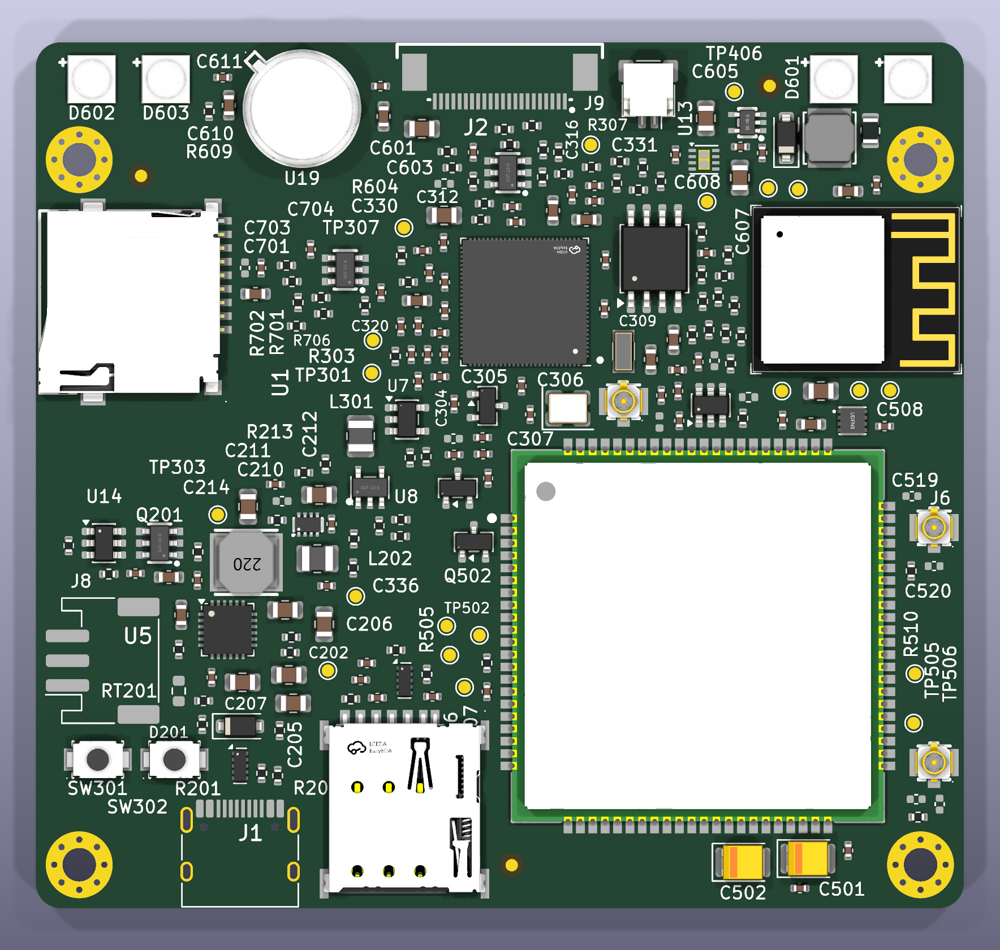
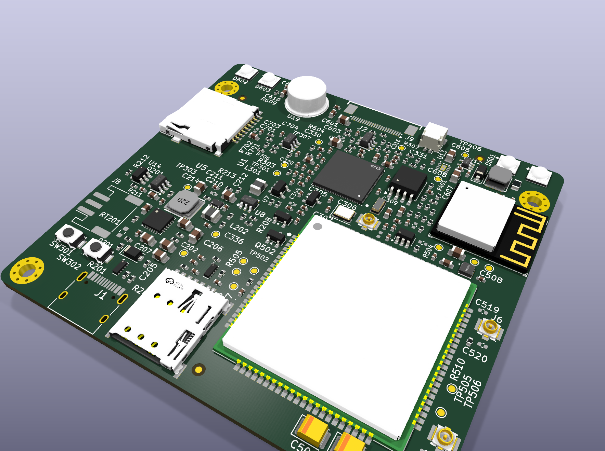
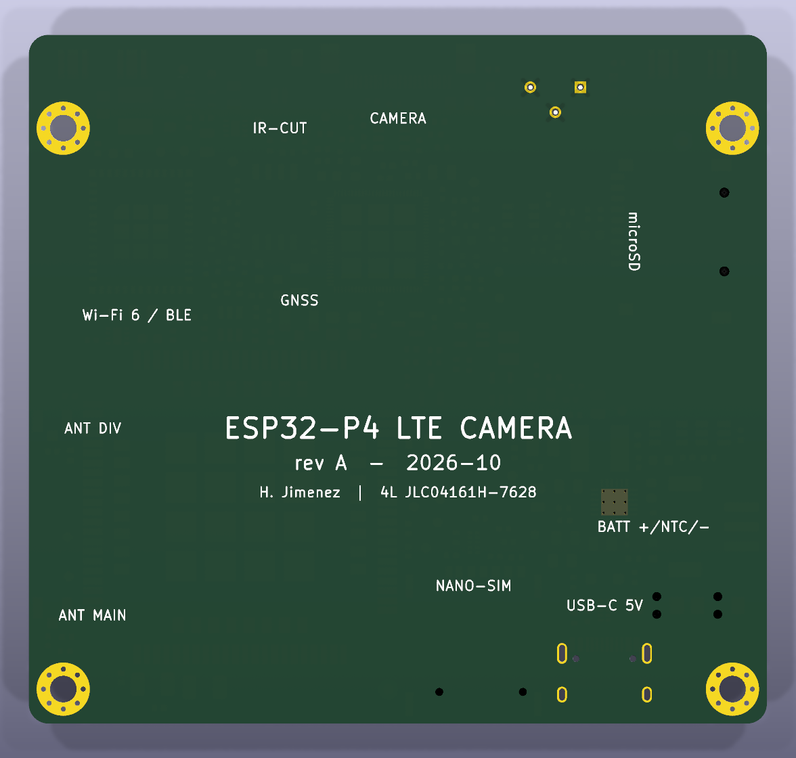

# Review 3 — Placement (rev A)

| | |
|---|---|
|  |  |

Package: renders above · [assembly drawing](placement/assembly_top.pdf) (every designator on F.Fab) · [metrics](placement/metrics.md) · pipeline `scripts/place.py → place_extras.py → silk.py` (re-runnable, deterministic).

## Status

| Check | Result |
|---|---|
| KiCad DRC `--severity-all` | **0 violations.** 499 unrouted connections, as expected before routing |
| Courtyards / pad clearance / board edge | Clean. Collision model = courtyard ∪ pads, because imported footprints draw body-only courtyards |
| Assembly | 234 parts, **single-sided (F)** as approved. PIR is the only THT part |
| Silkscreen | 1.0 mm designators where they fit (0.8 mm minimum). Key parts pinned (U1, U3, U4, U5, J1–J4). Dense passives are hidden on silk and kept on the assembly drawing |

## Placement decisions (changes from the Phase 1 floor plan)

1. **ESP32-P4 rotated 180°.** CSI-2 pins 41–48 then face the camera FPC directly, giving a **11.4 mm straight CSI path** with the six 0 Ω series pads in between. At 0° the lanes would have looped about 25 mm around the SoC. The flash pins now face U2 and the crystal pins face Y1/Y2.
2. **Card slots moved to edges.** The Phase 1 floor plan had the microSD and nano-SIM in the interior, where no card could be inserted.
   - **Nano-SIM** is on the bottom service edge beside USB-C, about 3 mm from the modem's USIM pins (17–20).
   - **microSD** is on the west edge, slot facing out.
   - The **C6 module** moved to the north-east corner. Its antenna (with its all-layer keep-out) hangs over the east edge, beside the P4's SDIO pins, about 15 mm from the nearest LTE U.FL.
3. **Modem** is bottom-right, unrotated. MAIN and DIV U.FLs sit on the east edge at pins 82 and 59, GNSS at pin 79. A **top-layer no-track rule area** covers the module body, per SIMCom's layout guide.
4. **Power** is grouped west: battery connector → DW01A/FS8205A → BQ25895 → TPS631000 → TPS7A02. The LTE switch U9 sits at the modem's VBAT pins, and the 2 × 220 µF tantalums at VBAT pins 38/39.
5. **Front edge** holds the camera FPC (cable exits north), the 4 IR LEDs in the corners (pairs, away from the lens), the PIR, the IR-cut connector and the IR boost driver.
6. **Fiducials** FID1–3 are global. The bottom silkscreen carries the board ID and a legend behind each connector.

## Metrics ([full table](placement/metrics.md))

| Item | Result |
|---|---|
| Switch-node loops (SW pin → inductor) | BQ25895 3.7 mm · TPS631000 2.2 mm · TLV62569 3.0 mm · TPS61169 5.6 mm (Schottky 2.3 mm) |
| 40 MHz crystal → XTAL_P | 4.6 mm |
| 32 kHz crystal → GPIO1 | 3.5 mm |
| CSI clock pin → FPC pin | 11.4 mm straight line |
| Decoupling caps ≤ 3 mm from their owner pin | **22 / 62** (P4 mean 3.6 mm, worst 9.2 mm) |

## Decision needed: ESP32-P4 decoupling on the bottom side

A 10 × 10 mm QFN-104 with 26 decoupling caps, 6 CSI series pads, 6 flash series pads and 2 USB resistors can't fit two good rings on one side. **Most of the 3–9 mm caps are P4 100 nF caps.** I prototyped the standard fix: the P4's 100 nF and 1 µF caps on B.Cu, directly under their supply pins ([board](placement/variant_bottom_decaps.kicad_pcb), [metrics](placement/metrics_bottom_decaps.md)).

| | Single-sided (current) | **P4 decaps on bottom (recommended)** |
|---|---|---|
| Caps ≤ 3 mm | 22 / 62 | **34 / 62** |
| P4 cap distance, mean / worst | 3.6 / 9.2 mm | **2.4 / 5.8 mm** |
| DRC | 0 | 0 |
| Assembly | JLC Standard, 1 side | JLC Standard, **2 sides** (one-off bottom-side setup fee; about 16 parts, all 0402 basic) |

Recommendation: **move the P4 decaps to the bottom.** It's the expected layout for a dense 0.35 mm QFN, it improves PDN impedance at the pins, and the bottom side is otherwise empty.

## Carried into routing

- Thermal-via arrays under the exposed pads (P4 EP, BQ25895, TPS22965, DRV8837) and stitching on the SIM7600 LGA GND pads (kicad-happy TV-001).
- GND pours on L1/L4, power pours on L3 (SYS, 3V3, VBAT_LTE), via fences along the RF CPWG feeds.
- 3D bodies are missing for the USB-C and JST PH (KiCad library paths). Fix in the final render pass.

### Analyzer notes (triaged)

KO-001 "U4 inside keep-out": expected, because the rule area only bans tracks. PM-002 "J3 0.33 mm from edge": the microSD slot is edge-mounted by design. TE-001 "7 % test-point coverage": deliberate. Test pads cover bring-up buses (UART0, C6 UART/USB, modem USB/debug, CHIP_PU/BOOT, spare GPIO).
